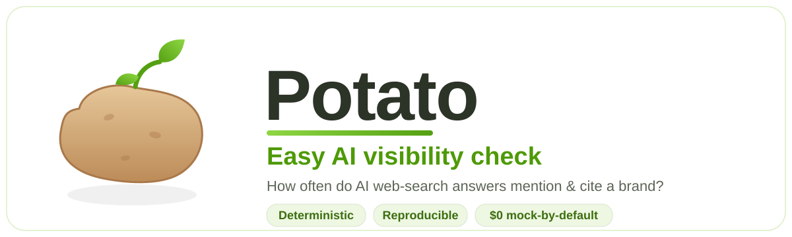
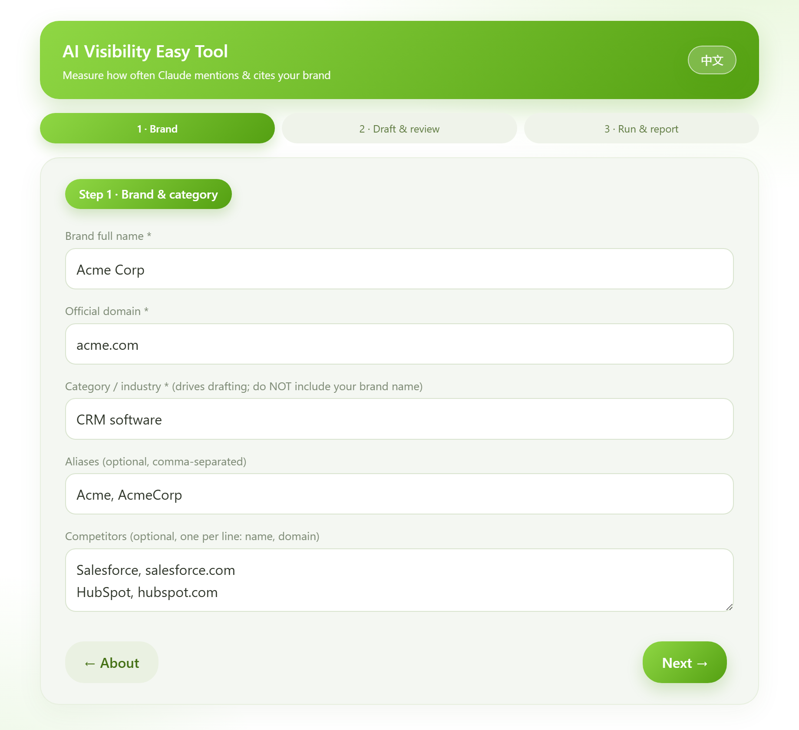
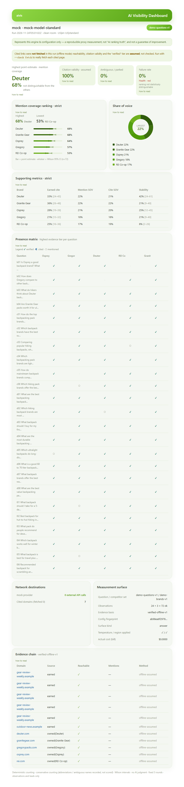

# 🥔 Potato

[English](README.md) · [中文](README.zh.md)

> Not a crawler, not an "AI-ranking truth detector", not a recommendation engine.
> Potato is a reproducible **proxy measurement** — every result represents **only this engine, under this exact config**.

---

## 1 · What Potato is

Potato measures how visible your brand is **inside AI web-search answers** — **Claude, ChatGPT (OpenAI), Gemini, Perplexity and Grok (xAI)** (27 models, pick any subset). It asks each AI you select the same fixed set of frozen questions, collects every brand **mention** and source **citation**, then scores them with **deterministic rules — no AI judge, no guesswork**. The result is one reproducible, auditable report **per engine**, plus a **side-by-side comparison** — engines are placed next to each other and **never blended into one score**. **Every number carries a confidence interval.**

---

## 2 · How to use it (Windows · no Python needed)

1. Download `AI-Visibility-Easy-Tool-windows.zip` from the **Releases** page (right-hand side of this repo).
2. **Unzip the whole folder first** — don't run it from inside the `.zip`.
3. Double-click **`AI-Visibility-Easy-Tool.bat`**.
4. A small black console window opens and your browser launches the wizard automatically. *(Keep that window open while you use the tool; close it to stop.)*
5. Follow the **3 steps** on the page:
   - **Brand** — your brand name, official domain, and category *(optional: aliases, competitors)*.
   - **Draft & review** — generate the question set (a **free template = $0, no key**, or **AI-drafted** with your own key), edit anything you like, and run the built-in quality check.
   - **Run & open report** — choose the **free mock preview ($0)** or a **real run**, tick **which AIs to test (multi-select)**, see the **per-AI estimate and total**, then open the **side-by-side comparison** and each engine's HTML report with one click. A **bill** (actual spend per AI) is shown when it finishes.

The portable build ships an **official, python.org-signed Python** (not a homemade `.exe`), so Windows **Smart App Control won't block it** — no code-signing certificate needed. The free preview needs no key and costs nothing.

**Developers / macOS / Linux:** `pip install -e ".[dev]"`, then `aivis gui` (wizard) or `aivis run --yes` ($0 mock). Build the portable zip with `python tools/build_portable.py`. *(The project is named Potato; the CLI command and Python package are `aivis`.)*

---

## 3 · What you get — and how it stays honest

A single-file, offline HTML report (no external links, no scripts). Above: a $0 mock demo with 5 neutral brands. A sample rendered with the real template from synthetic data (fictional brand, made-up numbers): <a href="examples/single_brand_report.html">examples/single_brand_report.html</a>.

### What it measures

- **Mention coverage** — how often an answer names your brand by a clear name.
- **Citation validity** — share of cited links that are reachable. In the default offline mode this is **assumed, not checked**, and the report says so at the top (see “verified” below).
- **Owned vs earned citations** — cited from your own domain vs third-party pages (counted **separately**, never blended).
- **Share of voice** — your share of all mentions across the measured brands.
- **Stability** — how consistent the result is across repeated rounds.
- **Prominence** — how early / prominently your brand shows up.
- **Presence matrix** — for each question, the strongest evidence reached: *mentioned → cited → verified*.
- **Evidence chain** — every cited URL: owned or earned, reachable or not, whether the page really mentions the brand, and the check method.
- A **ranking** with Wilson 95% confidence intervals, plus a **health light**.

### How it refuses to fabricate facts (the technical core)

- **Deterministic scoring, no AI judge.** Every counted number comes from fixed rules, not a model's opinion. AI is used only to *draft* questions (which you approve and freeze) — **never to decide the metrics**. Reports are rendered by fixed templates, not written by a model.
- **Conservative counting.** Only a clear, unambiguous brand name scores. Abbreviations and ambiguous names are recorded but **not counted** — the tool never rounds up in your favor.
- **Three evidence tiers — `mentioned → cited → verified` — and only `verified` enters the core score.** “Verified” comes in three strengths, and every report states which one it used: by default — and always in the wizard — cited links are **assumed** reachable and no page is fetched (`verified-offline-v1`); `--check head` checks the HTTP status; `--check fetch` fetches each cited page and requires that it is reachable **and really mentions the brand** (`verified-page-v2`, the strongest).
- **Independent citation check (opt-in).** With `--check fetch` on the command line, Potato re-fetches the pages the AI cited and checks them itself (dead links, pages that never mention the brand) instead of taking the AI's word for them. The default run does not fetch pages.
- **Clean room.** Every probe is a fresh call with no history and no personalization; region and temperature are pinned wherever the engine accepts them (see the honesty flags below), and the language is fixed by the frozen question text — the same question under the same conditions, every time.
- **Honest uncertainty.** Every ratio is shown with a Wilson 95% interval. When two brands' intervals overlap, Potato says **"not distinguishable"** instead of inventing a precise ranking.
- **No leading the witness.** 24 frozen questions (8 discovery / 6 comparison / 6 scenario / 4 brand-defense); the **first 20 never name any brand**, and those 20 are drafted **blind**, in a separate call that is never given your brand. Only the 4 brand-defense questions and the competitor suggestion are told which brand is yours.
- **We pinned the search tool that actually returns citations.** A newer web-search tool version silently dropped inline citations — we caught it empirically (**0 vs 12** citations) and pinned the version that keeps them.
- **Injection-safe.** Fetched web pages and AI answers are treated as untrusted data — never fed back to the model as instructions; HTML is sanitized.

### Regional categories → one national baseline

Some categories are answered differently depending on location. Potato **pins a single region** (e.g. US — sent to every engine that accepts a region parameter), asks one frozen question set in one language, and runs every probe clean-room, so a run is one consistent **national-level** view — not a blur of different cities, and not your personalized results. Different regions are measured as **separate strata** and are **never averaged together** into a single misleading number.

### Five engines, 27 models — compared side by side, never blended

| Engine | Models (verified against official docs 2026-09-22; Grok 2026-11-19) | How citations are read |
|---|---|---|
| **Claude** (Anthropic) | Haiku 4.5 · Sonnet 4.6 · Sonnet 5 · Opus 4.8 · Opus 5 · Fable 5.1 | inline `web_search` citations |
| **ChatGPT models** (OpenAI) | GPT-6 Luna / Sol / Astra · GPT-5.6 Luna / Terra / Sol | Responses API `url_citation` annotations |
| **Gemini** (Google) | 3.8 / 3.7 / 3.6 / 3.5 Flash · 3.1 Pro preview | Google Search grounding supports → chunks |
| **Perplexity** | Sonar · Sonar Pro (preset low) · Sonar Reasoning Pro (preset medium) · Search API | Agent API `url_citation` / `[n]` markers; Search API = result links |
| **Grok** (xAI) | Grok 4.20 (non-reasoning / reasoning) · 4.3 · 4.5 · 4.6 · 4.7 | Responses API `url_citation` annotations on inline `[[n]](url)` markers |

Each engine is its own **measurement surface**: it gets its own report, its own budget cap and its own bill. The comparison page places surfaces **side by side — no combined score, no cross-engine ranking**, because "visible on Gemini" and "visible on Claude" are different facts.

**Honesty flags are shown on every model card and recorded in every run manifest:**
- *no temperature* — the model rejects sampling parameters (all OpenAI reasoning models; Claude Sonnet 5 / Opus 4.8 / Opus 5 / Fable 5.1; Perplexity's two presets and its Search API), so the clean-room temperature cannot be pinned there;
- *no region* — the API has no region parameter (Gemini, Grok);
- *underlying model changes* — Perplexity's official presets run an OpenAI model that auto-updates and cannot be pinned (the manifest records the actual model each run);
- *search only* — Perplexity's Search API returns result links with **no generated answer**, so mention metrics do not apply (citation metrics still do);
- *Perplexity Sonar* (Agent API) answered **without inline citation markers** in our smoke run, so its citation metrics may read 0 while mention metrics work; the presets do carry `[web:n]` markers;
- *Grok 4.7* likewise answered **without inline citation markers** in our smoke run (2 of 2 calls). xAI then returns only a list of every page the agent browsed (about 50 URLs), which Potato does **not** count as citations — so its citation metrics may read 0 while mention metrics work. Grok 4.20 – 4.6 did cite inline;
- Grok's only request-side limit (`max_turns`) caps agent turns, not tool calls, and opening a page is billed like a search — so its pre-run estimate is deliberately wide (real smoke calls cost 22–62% of it); the run-time cap still stops new calls once the real spend reaches it;
- Gemini returns Google redirect links instead of real URLs; Potato resolves them by reading only the redirect header (no page fetch) so owned / earned attribution still works, and keeps the original link in the raw record.

The engine is **provider-agnostic by design**: every model sits behind one adapter interface, the model catalog lives in one file, and there are no model-specific branches in the pipeline — **you can add an engine by writing one adapter**.

---

## 4 · Bring your own API key

### What the key is for

- The **free preview (mock) needs no key and costs nothing.**
- A key is needed only for the steps that actually call an AI: **AI question drafting** (optional, uses Claude) and a **real measurement** (one key per engine you tick — Anthropic, OpenAI, Google Gemini, Perplexity, xAI; the Perplexity key covers both its Agent API and Search API).
- You bring your **own API keys**, and **each provider bills you directly**.

### What it costs

- **The author charges you nothing — ever. Potato is open source (MIT).**
- A full real check runs under **a budget cap you set, per AI**. Before it starts, Potato shows the **estimate (an upper bound) for every AI you tick and the total**: with the default 72 calls, lightweight models (GPT-6 Luna, Sonar, Gemini Flash, Claude Haiku) estimate at roughly **$2–6** and usually cost less; flagship models (Fable 5.1, GPT-6 Astra) cost more. A model whose estimate exceeds your cap is refused **before anything is spent**.
- During a run, once an AI's real spend reaches the cap **no new calls are sent**; calls already in flight (up to 4 by default) still finish and are billed. You then get a clearly labelled **partial report**, and **you choose**: raise the cap and continue the same run, or stop there.
- That money is AI usage paid to **the provider you chose**, never to the author.

### Security (verifiable, not just a promise)

- Runs **only on your machine** (`127.0.0.1`). There is **no cloud server, and nothing is uploaded.**
- Your key lives **in memory only**, passed to a local subprocess through an environment variable — **never written to disk, never logged, never placed on a command line.**
- Each key is sent **only to that provider's own API** — `api.anthropic.com`, `api.openai.com`, `generativelanguage.googleapis.com`, `api.perplexity.ai`, `api.x.ai` (your own accounts) — **never to any author server. Zero telemetry.** The endpoints are pinned in code: a relay or proxy address set in your environment (`*_BASE_URL`) is ignored.
- Open source and auditable; the report's **"network destinations"** panel lists which provider API was called and how many cited domains were checked. (For Gemini, Potato also sends header-only requests to Google's redirect host to turn its redirect links into real URLs — no key, no page content.)

---

### For developers & advanced use

- **Measure your own brand from the CLI / Claude Skill** (SETUP mode): `aivis init` scaffolds a focal config → `aivis validate` checks it → `aivis estimate` prices a run → `aivis run` executes it. See [SKILL.md](SKILL.md).
- **Multi-engine from the CLI:** `aivis models` lists all 30 catalog entries (27 real models + 3 mock) with flags and per-run estimates; `aivis run --surfaces openai:gpt-6-luna,gemini:gemini-3.8-flash,perplexity:search --yes` runs each surface, writes one report per surface plus `analysis/compare/<id>/comparison.html`, and prints the bill. Within a surface, questions are asked up to 4 at a time (`--concurrency N`; `1` = strictly one by one) — same calls, same results, just less waiting; if a budget cap is hit, up to N−1 calls already in flight still complete and are billed, the run writes a partial report and exits with code 6, and `aivis run --provider … --model … --run-id <id>` resumes it once you raise `budget_cap_usd`. Keys are read only from `ANTHROPIC_API_KEY` / `OPENAI_API_KEY` / `GEMINI_API_KEY` / `PERPLEXITY_API_KEY` / `XAI_API_KEY`.
- **Other flags:** `--sequential` (adaptive sampling — stop asking a question once its answers agree; default is a fixed 3 rounds), `--check offline|head|fetch` (how cited links are verified; default `offline`), `--run-id` (resume a run), `--data-dir`, `aivis gui --port N --no-open`.
- **Project map:** [SKILL.md](SKILL.md) · [ARCHITECTURE.md](ARCHITECTURE.md) · [CLAUDE.md](CLAUDE.md) (behavioral red lines) · `src/aivis/contracts/` (data contracts) · `configs/demo/` (neutral 5-brand demo).
- **Quality bar:** contracts frozen, three-layer storage (raw is append-only), deterministic pure scoring, golden tests, CI guards (ruff / mypy / import-linter / gitleaks / pytest) — **491 tests green.**

## License

[MIT](LICENSE).
