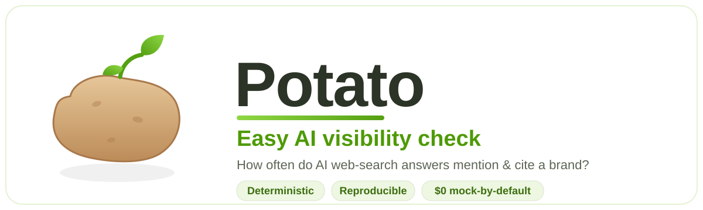
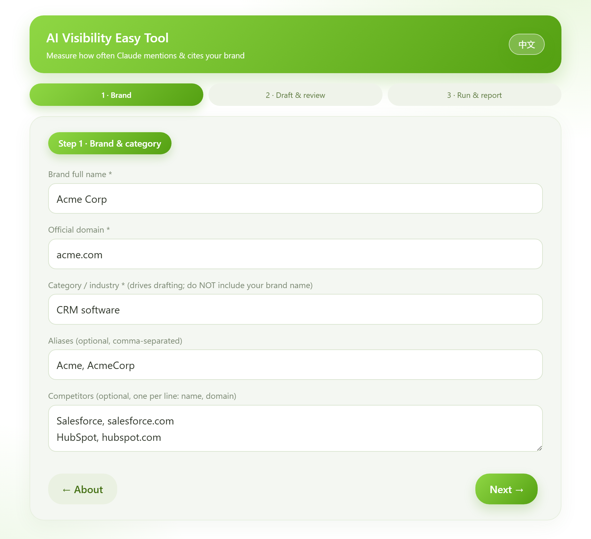
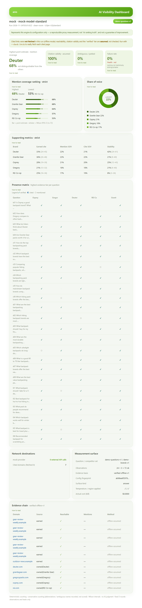

# 🥔 Potato · 轻松查 AI 可见度

[English](README.md) · [中文](README.zh.md)

> 它**不是**爬虫,不是"AI 排名真相检测器",也不是建议生成器。
> Potato 是一个**可复现的代理测量**——每个结果只代表**此引擎、此配置下**的表现。

---

## 1 · 这是什么(一句话)

Potato 测量你的品牌在 **AI 联网回答里**的可见度——**Claude、ChatGPT(OpenAI)、Gemini、Perplexity、Grok(xAI)** 五家 27 个模型,想测哪几个就勾哪几个。它用同一批**固定冻结的问题**反复问你选中的每个 AI,收集每一次品牌**提及**和来源**引用**,再用**确定性规则计分(非 AI 判官、不靠猜)**,给**每个引擎各出一份**可复现、可审计的报告,再加一页**并列对比**——引擎之间只并列、**绝不混成一个总分**。**每个数字都带不确定区间。**

---

## 2 · 怎么用(Windows · 无需装 Python)

1. 从本仓库 **Releases** 页(仓库右侧)下载 `AI-Visibility-Easy-Tool-windows.zip`。
2. **先把整个文件夹解压出来**——不要在压缩包里直接双击运行。
3. 双击 **`AI-Visibility-Easy-Tool.bat`**。
4. 会弹出一个黑色小窗口并**自动打开浏览器**进入向导。*(用的时候别关那个黑窗,关掉就停止了。)*
5. 按页面上的 **3 步**走:
   - **品牌** — 填品牌全名、官网域名、品类*(可选:别名、竞品)*。
   - **起草并审核题目** — 生成问题集(**免费模板 = $0、不用 key**,或用你自己的 key 让 **AI 起草**),逐题可改,跑内置质检。
   - **运行并打开报告** — 选**免费 mock 预览($0)**或**真实测量**,勾选**要测哪些 AI(可多选)**,看每个 AI 的预估和合计,完成后一键打开**并列对比页**和各引擎的 HTML 报告,并附**账单**(每个 AI 的实际花费)。

便携包内置 **python.org 官方签名的 Python**(不是自制 `.exe`),所以**不会被 Windows「智能应用控制」拦截**,也不需要任何代码签名证书。免费预览不用 key、零成本。

**开发者 / macOS / Linux:**`pip install -e ".[dev]"`,然后 `aivis gui`(向导)或 `aivis run --yes`($0 mock)。用 `python tools/build_portable.py` 构建便携 zip。*(项目门面名叫 Potato;CLI 命令与 Python 包仍是 `aivis`。)*

---

## 3 · 能跑出什么,以及它如何保证不编造

单文件、离线的 HTML 报告(无外链、无脚本)。上图是 $0 mock demo(5 个中立品牌)。在线样张:<a href="examples/single_brand_report.html">examples/single_brand_report.html</a>。

### 测量哪些指标

- **提及覆盖率** — 回答里用清晰品牌名提到你的频率。
- **引用有效性** — 被引用的链接里真正可达的比例。
- **自有 vs 第三方引用** — 引自你自己域名 vs 第三方页面(**分开计**,绝不混算)。
- **份额(SOV)** — 你在所测品牌全部提及中的占比。
- **稳定性** — 多轮重复下结果的一致程度。
- **位置 / 显著度** — 你出现得有多靠前、多突出。
- **在场矩阵** — 每道题达到的最强证据档:*提及 → 被引 → 已核验*。
- **证据链** — 每个被引 URL:自有还是第三方、是否可达、页面是否真提到品牌、用哪种核验方式。
- 带 **Wilson 95% 置信区间**的**排名**,以及一盏**健康灯**。

### 它如何拒绝编造事实(技术核心)

- **确定性计分、无 AI 判官。** 每个计入的数字都来自固定规则,不是模型的"看法"。AI 只用来*起草*题目(你审核拍板后冻结)和*叙述*报告——**绝不参与决定指标**。
- **保守计数。** 只有清晰、无歧义的品牌名才计分;缩写、歧义名只**记录不计分**——工具绝不替你"往上凑"。
- **三档证据 `提及 → 被引 → 已核验`,只有「已核验」进核心分。**「已核验」= Potato 真的抓取了被引页面,确认它可达**且页面里确实提到该品牌**。
- **独立核验引用。** Potato 会**自己重新抓取** AI 引用的第三方页面去查(死链、张冠李戴)——**不轻信** AI 的引用。
- **无尘室探测。** 每次提问都是全新调用、无历史、无个性化;区域、语言、温度全部钉死——同一道题、同一套条件,次次一致。
- **诚实的不确定性。** 每个比例都带 Wilson 95% 区间;当两个品牌区间重叠时,工具直接说**"无法区分"**,而不是硬编一个假精确的排名。
- **不诱导 AI。** 24 道冻结题(8 发现 / 6 比较 / 6 场景 / 4 防御);**前 20 道从不点名任何品牌**,而且你自己的品牌是**盲起草**的——AI 根本不知道哪个是你。
- **钉死了"真能返回引用"的搜索工具版本。** 某个较新的 web-search 工具版本会悄悄吞掉内联引用——我们实测抓到(**0 vs 12** 条引用),于是钉死了会保留引用的那个版本。
- **防注入。** 抓回的网页和 AI 回答一律当作**不可信数据**——绝不作为指令回喂给模型;HTML 做消毒。

### 有地域性的品类 → 统一取全国基线

有些品类的答案随地区不同而不同。Potato **钉死单一区域和语言**(如 US / en-US)并全程无尘室探测,所以一次运行给的是**一个一致的全国级视图**——不是不同城市的混合,也不是你的个性化结果。不同区域作为**独立分层(stratum)**测量,**绝不平均成一个会误导人的数字**。

### 五家引擎、27 个模型——只并列、不混总分

| 引擎 | 模型(对照官方文档核实:2026-09-22;Grok 2026-11-19) | 引用怎么读 |
|---|---|---|
| **Claude**(Anthropic) | Haiku 4.5 · Sonnet 4.6 · Sonnet 5 · Opus 4.8 · Opus 5 · Fable 5.1 | `web_search` 内联引用 |
| **ChatGPT 系列**(OpenAI) | GPT-6 Luna / Sol / Astra · GPT-5.6 Luna / Terra / Sol | Responses API 的 `url_citation` 标注 |
| **Gemini**(Google) | 3.8 / 3.7 / 3.6 / 3.5 Flash · 3.1 Pro 预览 | Google Search grounding 的 supports → chunks |
| **Perplexity** | Sonar · Sonar Pro(预设 low)· Sonar Reasoning Pro(预设 medium)· Search API | Agent API 的 `url_citation` / `[n]` 标记;Search API = 结果链接 |
| **Grok**(xAI) | Grok 4.20(非推理 / 推理)· 4.3 · 4.5 · 4.6 · 4.7 | Responses API 里行内 `[[n]](url)` 标记对应的 `url_citation` 标注 |

每个引擎是一个独立的**测量表面**:各有各的报告、各受各的预算上限约束、各出各的账单。对比页只把它们**并排放**——**没有合成总分、没有跨引擎排名**,因为"在 Gemini 上可见"和"在 Claude 上可见"是两件不同的事实。

**诚实标记会显示在每张模型卡上,并记进每次运行的清单:**
- *不接受温度*——该模型拒绝采样参数(OpenAI 全部推理模型;Claude Sonnet 5 / Opus 4.8 / Opus 5 / Fable 5.1),无尘室的温度在它那里钉不住;
- *无区域参数*——该接口没有区域参数(Gemini、Grok);
- *底层会变*——Perplexity 官方预设档底层跑的是 OpenAI 模型且自动更新、不可钉死(清单记录每次实际跑的模型);
- *纯搜索*——Perplexity Search API 只返回结果链接、**没有生成回答**,提及类指标不适用(引用类指标照常);
- *Perplexity Sonar*(Agent API)在我们的真机冒烟里**回答不带内联引用标记**,其引用类指标可能为 0,提及类指标正常;预设档的回答带 `[web:n]` 标记;
- *Grok 4.7* 在我们的真机冒烟里同样**回答不带行内引用标记**(2 次皆如此)。这时 xAI 只返回一份「代理浏览过的全部网页」清单(约 50 条),Potato **不把它算作引用**——所以它的引用类指标可能为 0,提及类指标正常。Grok 4.20 ~ 4.6 则有行内引用;
- Grok 请求侧唯一的上限(`max_turns`)卡的是代理轮数、不是工具调用数,而且打开网页和搜索一样按次计费——所以它的开跑前预估故意放得宽(真机冒烟的实际花费是预估的 22%~62%);运行中的预算硬封顶照常拦超支;
- Gemini 给的是 Google 跳转链接而非真实网址;Potato 只读跳转头(不抓页面)把它解析成真实网址,owned / earned 判定才能成立,原始链接照样留在原始记录里。

引擎**从设计上就与具体模型无关**:每个模型都藏在同一套适配器接口后面,模型目录集中在一个文件,流水线里没有任何针对某模型的分支——**接一个新引擎 = 写一个适配器**。

---

## 4 · 准备你自己的 API key

### key 用来干嘛

- **免费预览(mock)不用 key、零成本。**
- 只有真正会调用 AI 的步骤才需要 key:**AI 起草题目**(可选,用 Claude)和**真实测量**(勾了哪家就要哪家的 key——Anthropic、OpenAI、Google Gemini、Perplexity、xAI;Perplexity 一把 key 同时管 Agent API 和 Search API)。
- 你用**自己的 API key**,**由各家直接向你计费**。

### 花多少钱

- **作者不收你一分钱——永远不收。Potato 是开源的(MIT)。**
- 一次完整的真实检测**按你设的预算硬封顶,每个 AI 各自受限**——轻量模型(Claude Haiku、GPT-6 Luna、Gemini Flash、Sonar)通常 **$1–5**,旗舰模型(Fable 5.1、GPT-6 Astra)更贵。Potato 开跑前先给出**你勾选的每个 AI 的预估和合计**,**每个 AI 逼近预算就停、绝不超支**。这笔钱是付给**你选的 AI 提供商**的使用费,**不经作者**。

### 安全性(可自行核验,不是口头保证)

- **只在你自己电脑上运行**(`127.0.0.1`)。**没有任何云端服务器,不上传任何数据。**
- 你的 key **只存在内存里**,经环境变量传给本地子进程——**绝不写入硬盘、绝不进日志、绝不出现在命令行。**
- 每家的 key 只发往**那一家自己的接口**——`api.anthropic.com`、`api.openai.com`、`generativelanguage.googleapis.com`、`api.perplexity.ai`、`api.x.ai`(你自己的账号)——**绝不发往任何作者服务器,零遥测。**
- 开源可审计;报告里的**「网络去向」**面板会显示本次到底连了哪里,以上每条你都能自己验证。

---

### 给开发者 / 进阶用法

- **从 CLI / Claude Skill 测你自己的品牌**(SETUP 模式):`aivis init` 生成焦点配置骨架 → `aivis validate` 质检 → `aivis estimate` 估价 → `aivis run` 运行。详见 [SKILL.md](SKILL.md)。
- **CLI 多引擎:**`aivis models` 列出全部 30 个表面(含标记和按当前配置的预估);`aivis run --surfaces openai:gpt-6-luna,gemini:gemini-3.8-flash,perplexity:search --yes` 逐个表面跑、每个表面一份报告,再出 `analysis/compare/<id>/comparison.html` 并打印账单。同一个表面内默认同时问 4 道题(`--concurrency N`;`1` = 严格逐个问)——调用和结果都不变,只是少等;代价是预算封顶时已发出去的调用收不回,最多多花 N−1 次调用的钱。密钥只从 `ANTHROPIC_API_KEY` / `OPENAI_API_KEY` / `GEMINI_API_KEY` / `PERPLEXITY_API_KEY` / `XAI_API_KEY` 读取。
- **项目导读:**[SKILL.md](SKILL.md) · [ARCHITECTURE.md](ARCHITECTURE.md) · [CLAUDE.md](CLAUDE.md)(行为红线)· `src/aivis/contracts/`(数据契约)· `configs/demo/`(中立 5 品牌 demo)。
- **质量基线:**契约冻结、三层存储(raw 只追加)、确定性纯函数计分、黄金测试、CI 检查员(ruff / mypy / import-linter / gitleaks / pytest)——**350 测试全绿。**

## License

[MIT](LICENSE)。
